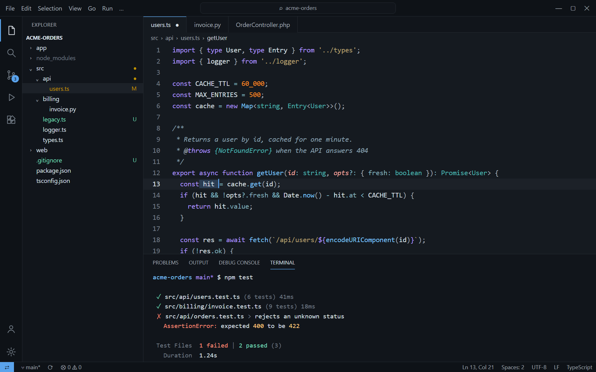
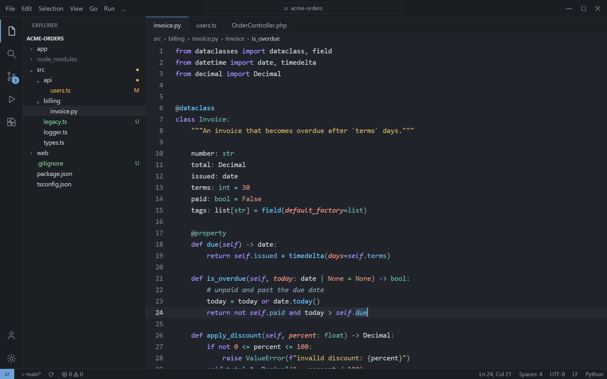
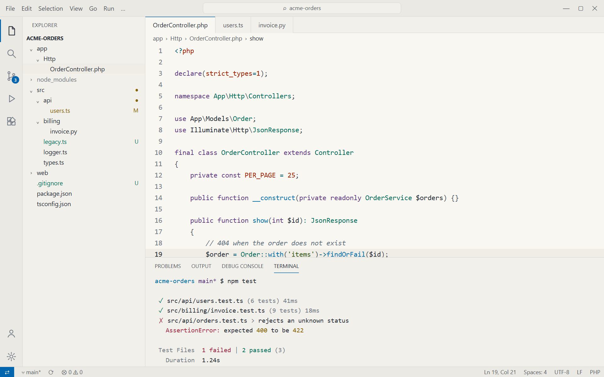
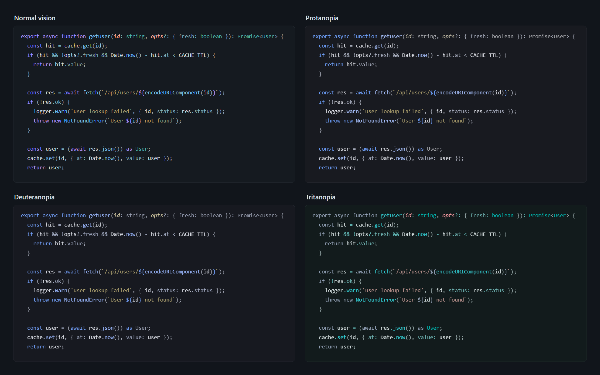

# Clearsight

A calm, readable theme for Visual Studio Code.



Most themes dim comments until they are hard to read, or crank saturation until long sessions hurt. Clearsight is built from one rule: **if it is on screen, you can read it.**

- Every syntax color, comments included, passes WCAG AA contrast (4.5:1) on the editor background and on the current line.
- Colors that need to be told apart (keywords and functions, strings and numbers, added and deleted lines, errors and warnings) stay distinguishable under protanopia, deuteranopia and tritanopia simulations.
- No syntax color is louder than your plain text, so code reads as text with accents rather than a light show.
- Contrast is checked automatically on every change, against both WCAG 2 and APCA.

## Variants

| Theme | For |
|---|---|
| Clearsight | Default dark theme |
| Clearsight Soft | Lower contrast for long sessions and light sensitivity, still AA everywhere |
| Clearsight Light | Daylight and bright rooms |

Each variant also ships a **No Italics** version.





## Built for colorblind developers

Roughly 1 in 12 men of Northern European descent has some form of red-green color vision deficiency. Clearsight never relies on red versus green alone: keywords, functions, types and strings stay apart through lightness as well as hue.



## Install

1. Open the Extensions view (`Ctrl+Shift+X` / `Cmd+Shift+X`).
2. Search for **Clearsight** and install it.
3. Open the Command Palette, run **Preferences: Color Theme**, and pick a Clearsight variant.

Clearsight is also published on Open VSX, so it works in Cursor, Windsurf and VSCodium.

## Other editors and terminals

The same palette is generated for Zed and for terminals. Terminal colors keep at least 4.8:1 contrast against the terminal background in every variant.

| App | File | How to use it |
| --- | --- | --- |
| Zed | [`zed/`](zed) | Until it is listed in Zed's extension store, run **zed: install dev extension** and pick the `zed` folder |
| Windows Terminal | [`extras/windows-terminal/clearsight.json`](extras/windows-terminal/clearsight.json) | Add a scheme to `"schemes"` in settings.json, then pick it under Appearance |
| Ghostty | [`extras/ghostty/`](extras/ghostty) | Copy a file to `~/.config/ghostty/themes/` and set `theme = Clearsight` |
| iTerm2 | [`extras/iterm2/`](extras/iterm2) | Settings > Profiles > Colors > Color Presets > Import |
| Alacritty | [`extras/alacritty/`](extras/alacritty) | Add the file to `import` under `[general]` |
| kitty | [`extras/kitty/`](extras/kitty) | `include` the file in kitty.conf |
| WezTerm | [`extras/wezterm/`](extras/wezterm) | Copy a file to your colors folder and set `color_scheme = "Clearsight"` |

All of them are built from the same source by `npm run ports`.

## Fonts

Themes cannot set fonts. Clearsight looks best with a font that has clear, distinct shapes, such as JetBrains Mono, Fira Code or Cascadia Code.

## Customizing

Override any color in your `settings.json`:

```json
"workbench.colorCustomizations": {
  "[Clearsight]": {
    "editor.lineHighlightBackground": "#1f252d"
  }
},
"editor.tokenColorCustomizations": {
  "[Clearsight]": {
    "comments": "#9fb3c2"
  }
}
```

## How the colors are checked

The palette lives in a single file and every variant is generated from it. A check script runs in CI and fails the build when any color drops below its contrast target or becomes too similar to its neighbour under a color vision deficiency simulation. The rules and the latest report are in the repository.

## License

MIT. Made by [TMS Outsource](https://tms-outsource.com).
